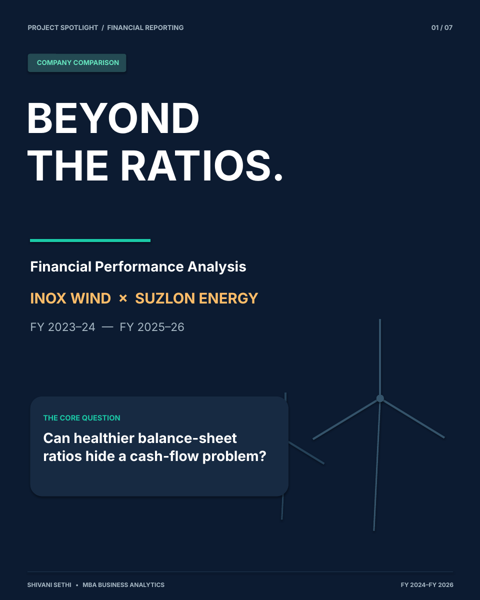

# Beyond the Ratios
### Financial Performance Analysis: Inox Wind vs Suzlon Energy

**A three-year financial analysis case study | FY 2023–24 to FY 2025–26**

*Shivani Sethi · MBA, Business Analytics · Lovely Professional University*

## Project overview

Can a company report improving liquidity ratios while still facing cash-flow pressure?

This MBA financial reporting case study compares **Inox Wind Limited** with **Suzlon Energy Limited** using their consolidated financial statements across three financial years. It covers **nine financial ratios** (54 company–year calculations), assesses the meaning behind the results, and translates key findings into proposed business actions.

> **Core finding:** In FY 2025–26, Inox Wind reported a **2.01x current ratio** and **₹449.10 crore net profit after tax**, but **₹598.12 crore in net operating cash outflow**. Improving balance-sheet ratios did not necessarily mean cash was being generated from operations.

## Project at a glance

| Dimension | Coverage |
| --- | --- |
| Companies | Inox Wind Limited; Suzlon Energy Limited |
| Period | FY 2023–24, FY 2024–25, FY 2025–26 |
| Financial ratios | 9 (liquidity, profitability, solvency) |
| Calculations | 54 (2 companies × 3 years × 9 ratios) |
| Analysis basis | Consolidated financial statements and annual report notes |
| Evidence | Annual reports and Screener company pages |
| Deliverables | Financial analysis report, visual carousel and ratio-summary CSV |

## Explore the project

- 📊 **[View the 7-slide visual presentation](presentation/Financial_Analysis_Carousel.pdf)** — easy-to-scan findings and recommendations.
- 📄 **[Read the full case study report](report/Financial_Analysis_Report.pdf)** — ratio comparison, methodology and supporting analysis.
- 🧾 **[Download the financial ratios dataset](data/financial_ratio_summary.csv)** — a tidy, 54-row company–year ratio summary with units.
- 🖥️ **[Editable presentation](presentation/Financial_Analysis_Carousel.pptx)** — PowerPoint source for the seven-slide presentation.

## What was analysed?

| Liquidity | Profitability | Solvency |
| --- | --- | --- |
| Current ratio | Operating ratio | Long-term debt–equity ratio |
| Quick ratio | Net profit margin | Interest coverage ratio |
| Cash ratio | Return on equity (ROE) | Proprietary ratio |

### Selected FY 2025–26 comparison

| Indicator | Inox Wind | Suzlon Energy |
| --- | ---: | ---: |
| Current ratio | 2.01x | 1.65x |
| Quick ratio | 1.52x | 1.08x |
| Cash ratio | 0.0345x | 0.1035x |
| Operating ratio | 84.38% | 84.10% |
| Net profit margin | 10.21% | 18.97% |
| Return on equity | 7.50% | 40.64% |
| Long-term debt–equity ratio | 0.0431x | 0.0109x |
| Interest coverage ratio | 4.30x | 6.24x |
| Proprietary ratio | 52.89% | 50.15% |

*Values are rounded for presentation. See the report for exact definitions and necessary comparability qualifications.*

## Key insights

**1. Liquidity improved, but cash conversion remained a challenge.** Inox's reported current and quick ratios strengthened, while FY 2025–26 operating cash flow was negative. Cash ratio and receivables quality matter alongside current-asset coverage.

**2. Suzlon led on reported profitability.** Its FY 2025–26 net profit margin and ROE were higher. However, reported profits included material deferred-tax benefits; these should not be mistaken for recurring operating earnings.

**3. Solvency needs a broader lens.** Inox's interest coverage improved to 4.30x in FY 2025–26, while Suzlon's was 6.24x. A low ratio of *non-current* borrowings to equity is not evidence that short-term funding or other obligations are absent.

## Recommendations: 3C framework

The project applies **Current Situation → Consequences → Corrections** to turn ratio movements into business recommendations. Proposed actions for Inox include:

- Establishing a rolling **13-week cash forecast** and monitoring overdue receivables.
- Improving project-milestone billing, collection follow-ups and working-capital discipline.
- Reviewing project cost overruns, pricing and procurement to defend operating margins.
- Matching financing maturities to cash-generating assets and assessing returns on equity-funded investment.

*These are analytical recommendations, not statements that either company has adopted them.*

## Method and limitations

1. Financial inputs were compiled from the companies' **consolidated** statements and accompanying notes for FY 2023–24 through FY 2025–26.
2. Nine financial ratios were calculated for both companies over three years. The dataset preserves the rounded values presented in the case study; it is **not** a raw annual-report data export.
3. Ratio comparisons were complemented by cash-flow and quality-of-earnings analysis.
4. Definitions matter: ROE uses profit attributable to owners over average owner equity; debt–equity focuses on **non-current long-term borrowings** under the coursework convention, not total debt.
5. Inox's comparative statements included restatements and changes in consolidation scope, limiting strict year-to-year comparability. Suzlon's reported net margin was affected by tax credits.

Read the report's **methodology and source notes** before reusing figures outside this case study.

## Sources

- [Screener — Inox Wind (consolidated)](https://www.screener.in/company/INOXWIND/consolidated/)
- [Screener — Suzlon Energy (consolidated)](https://www.screener.in/company/SUZLON/consolidated/)
- Inox Wind Limited annual reports, FY 2024–25 and FY 2025–26 (consolidated statements and notes)
- Suzlon Energy Limited annual reports, FY 2024–25 and FY 2025–26 (consolidated statements and notes)

**Disclaimer:** Educational financial analysis prepared as part of MBA coursework. This repository is not investment advice or a current assessment of either company's stock.
